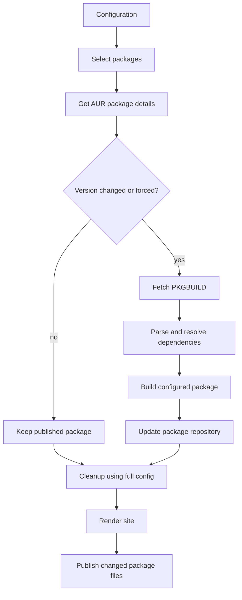

# MyRepo Builder: Clean-Room Specification

This document explains how to build a package-builder program in any language. It lists what goes in, what the program must do, what files it must create, how failures are handled, and how to test the result. You do not need this repository's source code to use it.

## Contents

- [MyRepo Builder: Clean-Room Specification](#myrepo-builder-clean-room-specification)
  - [Contents](#contents)
  - [Purpose and Scope](#purpose-and-scope)
  - [Key Terms](#key-terms)
  - [Tools Used](#tools-used)
  - [Settings](#settings)
  - [Commands](#commands)
  - [Build Steps](#build-steps)
  - [Getting Packages from AUR](#getting-packages-from-aur)
  - [Finding Required Packages](#finding-required-packages)
    - [Read dependency lists](#read-dependency-lists)
    - [Find and install missing packages](#find-and-install-missing-packages)
  - [Package Files and Repository](#package-files-and-repository)
  - [Website](#website)
  - [Automatic Builds](#automatic-builds)
  - [Errors and Saved Results](#errors-and-saved-results)
  - [Tests to Pass](#tests-to-pass)

## Purpose and Scope

The program has three jobs:

1. **Build packages:** check the settings, choose packages, compare versions, find required packages, and run Arch's build tools.
2. **Update the package repository:** add successfully built packages, remove old entries, and save a summary of the run.
3. **Publish results:** make a package-list website and let an automation service upload the files.

The PKGBUILD file and `makepkg` do the actual source build. `repo-add` and `repo-remove` update the package list that Arch clients use. Use these tools regardless of the programming language used for the builder.



## Key Terms

- **AUR:** a community site where Arch users share package build recipes.
- **PKGBUILD:** a shell script that tells Arch how to download, build, and package software.
- **Dependency:** another package needed to use, build, or test a package.
- **Package base:** one AUR source checkout that can create one or more installable packages.
- **Provider:** a package that says it can be used under another package name.
- **SRCINFO:** the dependency and package details printed by `makepkg --printsrcinfo`.
- **Repository database:** the index Arch uses to find packages in a package repository.
- **YAML:** the text format used for settings in `config.yml`.
- **JSON:** the text format used for package lists and run summaries.
- **CI:** an automated service that runs builds and publishes their results.

## Tools Used

| Tool                       | What it does                                                                                                                           |
| -------------------------- | -------------------------------------------------------------------------------------------------------------------------------------- |
| AUR web API, version 5     | Returns package details, versions, dependency lists, and search results for substitute packages                                        |
| Git                        | Downloads and updates AUR package bases and checks upstream commits for `-git` packages                                                |
| `makepkg`                  | Reads PKGBUILDs, prints package details, and creates installable package files                                                         |
| `pacman`                   | Checks installed packages, finds and installs packages from Arch repositories, inspects package files, and installs AUR-built packages |
| `vercmp`                   | Compare versions using Arch's version rules                                                                                            |
| `repo-add` / `repo-remove` | Add or remove packages from the repository database                                                                                    |
| GitHub Release             | Stores package files and the repository database between automated runs                                                                |
| Website hosting            | Serves the generated package list and install instructions                                                                             |

When starting another program, pass its arguments separately, check whether it succeeded, and show its error message. Put a time limit on network requests. PKGBUILD files can run commands on the machine, so build them only in a trusted Arch environment and avoid giving them unnecessary administrator access.

## Settings

Read a YAML settings file. The default name is `config.yml`; an explicit command-line path overrides it. Resolve relative paths from the folder where the program was started. Reject malformed YAML and wrong value types before changing the package repository.

Example:

```yaml
repo:
  name: my-repo
  url: https://github.com/OWNER/REPOSITORY
  desc: Community Arch packages
  down_suffix: /releases/download/repo
  output_dir: build
  clone_dir: aur
  # Optional: display_name, install_cmd, packager

aur:
  url: https://aur.archlinux.org
  pkg_base: /packages

site:
  url: https://OWNER.github.io/REPOSITORY
  name: My Repo
  desc: Community Arch packages
  input_dir: site-assets
  output_dir: dist

packages:
  - package-name
  - another-package:
      always: true
      extra_pkgs: [extra-build-tool]
```

`repo.name`, `repo.url`, and `site.url` are required. A build also needs at least one configured package. Defaults are repository output `build`, site output `dist`, checkout folder `aur`, processor type `x86_64`, repository download suffix `/releases/download/repo`, and AUR base URL `https://aur.archlinux.org`. The AUR API address is the base URL plus `/rpc/`; the AUR package-page base is `/packages`. A missing site name or description uses the repository display name or description. The site URL must start with `http://` or `https://`.

`packages` is an ordered list. Each item is either a package-name string or a mapping with exactly one package name and an options mapping. Supported package options are:

| Option       | Type                      | Default | Effect                                          |
| ------------ | ------------------------- | ------- | ----------------------------------------------- |
| `always`     | Boolean                   | `false` | Build even if its published version matches AUR |
| `extra_pkgs` | List of non-empty strings | `[]`    | Add packages to build requirements              |

Each package mapping must contain exactly one package name. Its options may be empty. `always` must be a Boolean and `extra_pkgs` must be a list of non-empty strings. Trim spaces around package names and extra package names. Ignore unknown package option keys for compatibility, but a warning is helpful. A name such as `tool|always` is one literal package name, not a special form. Put the repository database at `<output_dir>/<architecture>/<repo-name>.db.tar.gz`.

## Commands

Provide commands equivalent to:

```text
builder [--config FILE] build [--package NAME ...] [--rebuild-missing]
builder [--config FILE] build-index
builder [--config FILE] --version
```

- `build` selects packages, checks versions, builds needed targets, updates the repository database, performs cleanup, and writes summaries.
- `--package NAME` may be repeated and selects only configured package names. An empty selection is an error.
- `BUILD_TARGETS` is used only when no command-line package was supplied. Accept either a JSON list or package names separated by spaces.
- `--rebuild-missing` rebuilds a version-matching package if its expected archive is absent.
- `build-index` only renders the site from an existing, valid repository database.
- `--version` prints the implementation version.

Return exit code `0` only if the requested operation succeeds. Return a failure code for bad settings, missing AUR packages, missing requirements, build problems, database problems, or website problems. Continue unrelated package builds after a failure when safe, but still return a failure code. Automation must never publish a failed build as successful.

## Build Steps

Perform a build in this order:

1. Verify required host tools are available. At minimum, building requires `makepkg`; dependency installation requires pacman; database changes require `repo-add` and sometimes `repo-remove`.
2. Load and validate configuration before mutating repository state.
3. Keep the full configured package set separate from the selected build set. Targeted cleanup must use the full set.
4. Prepare the output folder for the selected processor type and remove only temporary result files from an earlier run. Check that the output folder can be written to.
5. If exactly one old-named repository database exists, rename it and its related files to the configured repository name. If there are several possible old databases, stop instead of guessing.
6. Query AUR versions for every selected target. If any selected name is absent, report all missing names and do not begin the selected package builds.
7. For each selected target, look up its published version and decide whether it needs rebuilding.
8. For each target that needs a build, fetch/update its AUR package base, extract dependencies, resolve them, and invoke `makepkg`.
9. Copy successful configured-target archives into the output directory and update the database for those archives.
10. Remove stale versions and packages no longer configured, without removing other configured packages during a targeted run.
11. Write summaries and change markers. Return a failure code if any selected package failed.

For a normal package, build when forced, when no repository version exists, or when the AUR and repository versions differ. For `-git` packages, inspect the PKGBUILD for `pkgver()`. If present, read Git sources from its evaluated source array and query the first Git source's selected ref with `git ls-remote`. If the remote short hash is already represented in the published version, treat it as unchanged; if it differs or there is no published version, build. If the remote query fails, retain the current published package rather than rebuilding solely because of a network failure. Without `pkgver()`, use the PKGBUILD's static epoch/version/release value.

Support Git source forms `git+https://...`, `git://...`, optional `name::` prefixes, and `#branch=`, `#tag=`, or `#commit=` fragments. Map branch and tag values to their corresponding `refs/heads/` and `refs/tags/` refs; use a supplied commit directly; use `HEAD` when no ref is specified.

## Getting Packages from AUR

Use the AUR version 5 web API. For package details, send `type=info` and one `arg[]` parameter for each name. For substitute packages, send `type=search`, `by=provides`, and `arg=<requested-name>`. A result uses these fields:

| API field      | Meaning                                 |
| -------------- | --------------------------------------- |
| `Name`         | Installable package name                |
| `PackageBase`  | Name of its AUR source repository       |
| `Version`      | Package version                         |
| `Depends`      | Packages needed to use it               |
| `MakeDepends`  | Packages needed to build it             |
| `CheckDepends` | Packages needed to test it              |
| `Provides`     | Other package names it can stand in for |

For example, package information uses a URL like:

```text
https://aur.archlinux.org/rpc/?v=5&type=info&arg%5B%5D=package-name
```

A provider search uses `https://aur.archlinux.org/rpc/?v=5&type=search&by=provides&arg=package-name`. Fetch full package details for every search result before choosing one. Treat network errors, timeouts, unsuccessful web responses, and unreadable responses as errors; do not treat an API failure as “no results.”

Keep one source copy per package base in a configurable cache. Clone it from `<git-base-url>/<package-base>.git` when missing; update an existing copy with `git pull` before use. Confirm that it contains a PKGBUILD file. Git source entries may use `git+https://...`, `git://...`, a `name::` prefix, or a `#branch=`, `#tag=`, or `#commit=` suffix.

## Finding Required Packages

### Read dependency lists

Run `makepkg --printsrcinfo` in the package checkout. It prints the package's dependency lists as text. Trim spaces and tabs from each line before reading it because the output indents its fields. Collect:

- `depends`: packages needed when the built package is installed;
- `makedepends`: packages needed to build it;
- `checkdepends`: packages needed to run its tests;
- fields for the selected processor type, such as `depends_x86_64`;
- configured `extra_pkgs`, added to the build list.

Do not include fields for a different processor type or optional packages. Remove duplicates without changing the order. If the dependency list cannot be read, stop before building. An empty list is valid only when the PKGBUILD has no required packages.

### Find and install missing packages

For every required package, first ask pacman whether it is already installed. For a rule such as `thing>=2`, use Arch's version comparison rules. Do not compare version text alphabetically.

Use these commands for the checks and installs:

| Purpose                             | Command shape                                                   |
| ----------------------------------- | --------------------------------------------------------------- |
| Check installed packages            | `pacman -T 'thing>=2'`                                          |
| Check official repositories         | `pacman -Sp --print-format %n 'thing>=2'`                       |
| Install an official package         | `sudo pacman -S --noconfirm --needed 'thing>=2'`                |
| Read a package name from an archive | `pacman -Qp --print-format %n /path/to/file.pkg.tar.zst`        |
| Install a built AUR package         | `sudo pacman -U --noconfirm --needed /path/to/file.pkg.tar.zst` |
| Compare two Arch versions           | `vercmp 2.1 2.0`                                                |

Use the system's configured privilege helper in place of `sudo` if needed. After each install, check the original requirement again with `pacman -T`.

For a package that is not already installed:

1. Ask pacman whether one of the enabled Arch repositories can install the requested name. This also lets pacman find repository packages that provide another name.
2. If a repository package can satisfy it, install it and check the original requirement again.
3. If not, look in the AUR for a package with that exact name and a suitable version.
4. If there is no suitable exact match, look for AUR packages that list the requested name under `provides`. A plain requirement can use a plain provide. A versioned requirement needs a provide with a version that meets the same rule.
5. Prefer an exact name. If several AUR packages could work, choose them in a stable, documented order or ask the user in interactive mode. Never pick an arbitrary provider in an unattended build.
6. Before building an AUR dependency, read its own required package lists and resolve those first. Keep track of the current chain of packages; report and stop if a package depends on itself through that chain.
7. Build the dependency only after all of its requirements are installed. For a source package that makes several binary packages, inspect each archive to find the requested package by its recorded name.
8. Install that archive, then ask pacman again whether it satisfies the original requirement. Stop with an error if it does not.

If several requested packages come from the same package base, download and build that source only once. Install AUR dependencies on the build machine so later builds can use them, but do not add their package files to the hosted repository unless they are configured targets.

Build the configured target only after all packages it needs to run, build, and test are installed. The `--nodeps` option tells `makepkg` to skip its own dependency check, so use it only after this program has checked every requirement. If no installed package, Arch repository, or AUR package can meet a requirement, report it and fail that target.

## Package Files and Repository

Build the configured target only after its required packages are installed. Run `makepkg --noconfirm --nodeps --force --clean`; this skips makepkg's own dependency check, so the builder must have checked requirements first. Collect `*.pkg.tar.zst` archives and, if supported, `*.pkg.tar.xz` or `*.pkg.tar.gz` archives. Confirm that the target archive exists, copy it into `<output_dir>/<architecture>/`, then remove its temporary copy from the source folder.

Use `repo-add` to add successful configured-target archives to `<repo-name>.db.tar.gz`. Use `repo-remove` to remove packages no longer configured. The pacman database is the source of truth for published package versions and the package list shown on the site.

A pacman database is a compressed tar file. It contains one folder per package, with a `desc` text file in each folder. Read fields such as `%NAME%`, `%VERSION%`, `%DESC%`, `%FILENAME%`, `%ARCH%`, `%URL%`, and `%DEPENDS%` to get package details. Use `repo-add` and `repo-remove` to write changes rather than editing this file format by hand.

Before a build, automation may download the existing database and package files from release storage. After a successful build, upload changed package archives and database files. Keep package archives separate from database files; both are needed by clients of the repository.

Cleanup must use the full configured package list, even during a build of only one selected target. Remove an old archive only after its replacement was successfully built and added to the database. Do not remove a configured package because its build failed or it was skipped as current.

Write these state files under the output folder:

| File                    | Meaning                                                                                              |
| ----------------------- | ---------------------------------------------------------------------------------------------------- |
| `build-summary.json`    | A list of built packages. Each item has `name`, `old_version`, `new_version`, `filename`, and `size` |
| `missing-packages.json` | Selected package names not found in AUR, when applicable                                             |
| `removed-packages.json` | Package names removed from the repository                                                            |
| `.db-updated`           | The repository database changed during this run                                                      |

Clear only state files that belong to a new run. Write JSON safely so an interrupted run does not leave a half-written file.

## Website

Render a static website from a configurable input folder into an output folder. Read its package list from the pacman database so the site shows what is actually published.

Replace text placeholders like `{{repo_name}}` with values from the configuration. The built-in page uses these names:

`builder_name`, `builder_version`, `builder_url`, `repo_name`, `repo_display_name`, `repo_url`, `repo_desc`, `repo_pkg_count`, `repo_down_suffix`, `repo_dwn_url`, `repo_install_cmd`, `repo_packager`, `last_updated`, `ci_run_url`, `ci_run_hash`, `site_url`, `site_name`, and `site_desc`.

Fail if a page uses a placeholder that has no value; do not publish a page with unresolved placeholders. Copy images and other non-text files unchanged, create output folders as needed, and keep useful file permissions.

Write a `packages.json` file in the site output folder. It is a list of package records with these fields:

| Field              | Meaning                                                     |
| ------------------ | ----------------------------------------------------------- |
| `pkg_name`         | Installable package name                                    |
| `pkg_desc`         | Short package description                                   |
| `pkg_version`      | Published version                                           |
| `pkg_aur_url`      | Link to the package's AUR page                              |
| `pkg_arch`         | Supported processor type, such as `x86_64` or `any`         |
| `pkg_filename`     | Package archive filename                                    |
| `pkg_download_url` | Full download link for the archive                          |
| `pkg_project_url`  | Upstream project link, or an empty value if invalid/missing |

The page can use this file to show package names, descriptions, versions, processor types, and links. The built-in page also supports searching, copying the install command, downloading a package, and opening its AUR or project page. The default install command is `curl -fSL {site_url}/setup | bash`.

`last_updated` is the current time in Unix seconds. `ci_run_hash` is a short commit ID (up to seven characters), or `local` when no commit can be found. Use an explicitly supplied CI run URL when available; otherwise form one from the automation service or link to the repository's Actions page.

Fail if the input folder or a valid repository database is missing, or if the output path cannot be used as a folder. The generated website is an output; automation publishes it after a successful build.

## Automatic Builds

Run the builder in an Arch Linux environment with `base-devel`, Git, pacman, `makepkg`, repository database tools, and any build tools needed by the selected packages. Run PKGBUILDs as a build user that can install packages through the system's normal privilege helper.

A CI job is the wrapper around the builder. It starts builds after changes to settings or build code, on a schedule, or after a manual or external request. The current schedule is every 12 hours at minute 47. Manual requests may name packages and may ask for the website to be refreshed even if no package was rebuilt.

Use this order for each CI run:

1. Start a fresh Arch Linux environment, install system tools, check out the project, and install the builder. Create a non-root build user with permission to install needed packages.
2. Download the current repository database and package-list files from the release store into `<output_dir>/<architecture>/`. The builder needs this old database to compare versions and clean up correctly.
3. If the run names packages, pass them to the builder using `BUILD_TARGETS`. If no package list is supplied, let the builder use all configured packages.
4. Run `builder build`. Keep its exit code and output files. The builder writes package archives and the `.db-updated` marker when repository contents change.
5. If the build fails, do not upload packages or deploy the website. Still write a CI run summary that explains the failure.
6. If the build succeeds, run `builder build-index`. The builder reads the updated package database and writes the website to the configured site output folder.
7. Check for newly built package archives and `.db-updated`. If either shows a repository change, upload the new archives and database files to the release. Remove older release files for replaced package versions and files for packages no longer configured.
8. If there are no package changes, skip release uploads unless a site refresh was requested or site files/templates changed. Deploy the generated website only after the build succeeds.
9. Always write a run summary. Pass the CI run URL and short commit ID to the site builder so the page can link back to its build.

Do not let two jobs change the same repository at once; cancel an older run when a newer run replaces it. Keep release uploads, website publishing, credentials, and caches in the CI setup. Keep package selection, dependency handling, build decisions, summaries, and exit codes in the builder so it works the same locally and in CI.

## Errors and Saved Results

Each error should say which step failed and name the affected package or requirement. Distinguish configuration problems, missing AUR packages, network errors, source download errors, unreadable dependency lists, missing dependencies, version mismatches, dependency cycles, install errors, build errors, missing output archives, database errors, and site errors.

Do not build a package after one of its required steps fails. Other selected packages may continue if they do not depend on the failed package. Always return a failure status if any requested package failed. Do not publish a package as successful until its archive is in the repository database.

Keep console logs useful in both a terminal and CI. Optionally write timestamped log files. For a dependency problem, report the requested name, whether it was checked as installed or searched in Arch repositories/AUR, the selected provider if any, and the failing tool's message. Never print credentials.

Write state so an interruption does not leave a partly written file. At the start of a run, remove only the previous run's summary and status files.

## Tests to Pass

Tests should check behavior without network access, administrator access, or real package installation. Use made-up AUR and pacman responses instead. At minimum, test:

1. Valid and invalid configuration, including both supported package-entry forms.
2. Indented SRCINFO fields, all three required dependency groups, architecture-specific fields, extra packages, and duplicate removal.
3. Already-installed dependencies, official repository packages, and repository packages that provide an alternate name.
4. Nested AUR dependencies are built and installed before the package that needs them.
5. Exact AUR matches, virtual providers, version rules, missing providers, and dependency cycles.
6. Split packages use one source checkout/build and select the correct archive by its recorded package name.
7. Build or install failures return failure and do not replace a previously published package.
8. A targeted build preserves every other configured package during cleanup.
9. Repository database changes and state files match the successful builds and removals.
10. Site placeholders, package rows, missing database behavior, and copying of images/binary files.
11. Command-line target precedence, missing-archive rebuilds, `-git` update checks, summaries, and exit codes.

Also run one real build in a temporary Arch Linux environment. Check that it installs packages, runs the PKGBUILD, creates an installable package file, updates the repository database, and builds the website. Tests with made-up tool responses cannot prove these real steps work.
